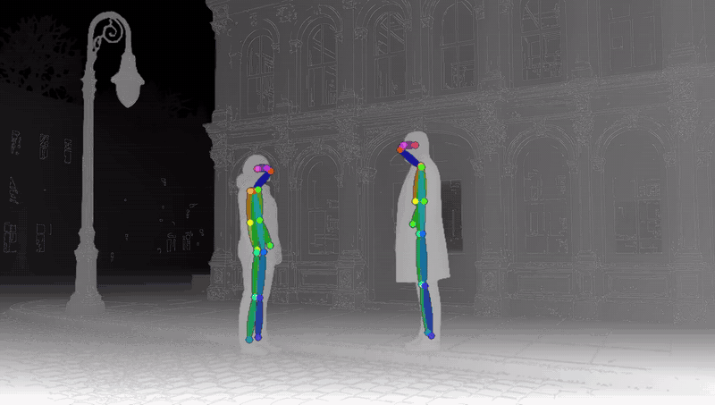
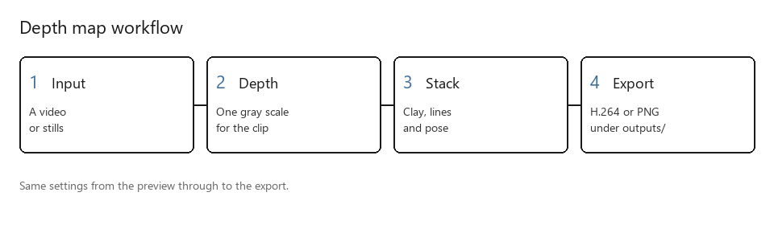
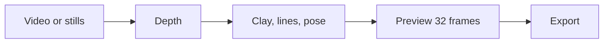

# Depth Map Converter

A local app that turns a video or a still into a depth map, then can stack clay shading, lines and a pose on top of it.

[](docs/media/depth-sample.mp4)

*Output from one clip: depth with Canny edges and a pose skeleton stacked on top, all from a single run. Near is white. [Play the full MP4.](docs/media/depth-sample.mp4)*

## Why it exists

A depth map made one frame at a time flickers, because each frame picks its own gray scale. This app uses a video depth model, so the whole clip shares one scale. The file it writes is the map. It does not need a Stable Diffusion install.

## How it works





- **Video** uses [Video Depth Anything](https://github.com/DepthAnything/Video-Depth-Anything). Near is white.
- **Stills** use Depth Anything V2. A still model is not run on every video frame.
- **Stack.** Clay is a gray shaded version of the depth, lit from the upper left. Canny edges, line art and an OpenPose skeleton can sit on top. Up to four layers, each with an opacity.
- **Preview** converts 32 frames with the same settings as the export, so the contrast you set is the contrast you get.

## Results

On a 16 GB GPU, Auto picked the Large model at input size 518. That fit in about 10.5 GB after the upstream dense attention was swapped for PyTorch's memory-efficient attention. Smaller cards step down on their own.

| Job | Model |
|---|---|
| Video depth | Video Depth Anything Small, Base or Large |
| Image depth | Depth Anything V2 Small, Base or Large |
| Canny | OpenCV |
| Clay | Shaded from the depth |
| Lines, soft edge, pose, normal | controlnet_aux, downloaded on first use |

Small weights are Apache-2.0. Base and Large weights are CC-BY-NC-4.0, so they are not for commercial use. The Video Depth Anything code is Apache-2.0.

## Quick start

```bash
python install.py
python start.py
```

`install.py` makes a `.venv`, installs a CUDA build of PyTorch, and downloads the weights. `start.py` asks which GPU to use and opens http://127.0.0.1:7860. Or double-click `start.bat`.

```bash
python start.py --gpu 0
python start.py --cpu
```

Load a video or some images, tick the maps, press Preview, then Generate. Output goes under `outputs/`.

<details>
<summary>Export settings</summary>

Video export is H.264 `yuv420p`, the original frame rate, CRF 14, with the original audio when the file has any. Dither stays on so the gray steps survive compression. **Max seconds** defaults to 60. Set it to 0 for the whole file.

Images are PNG. A video can also write a PNG sequence and a raw float `.npz`.

Depth contrast locks or loosens the depth layer. Clay relief controls how modeled the clay looks. Alpha blend mixes the whole frame. Transparent overlay knocks out pixels that match the border, so lines sit on the form without a black field.

Saved choices go in `preferences.json`, which is gitignored.

</details>

## How it was built

Built by directing AI coding agents in Cursor. I set the design and the acceptance bar. The agents wrote the code. No license file: all rights reserved.
